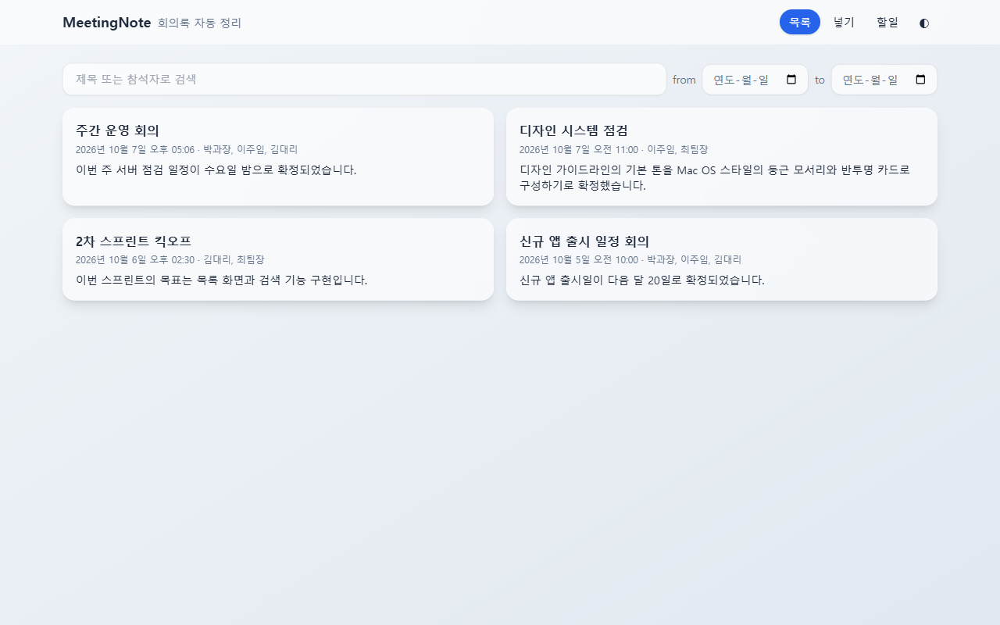
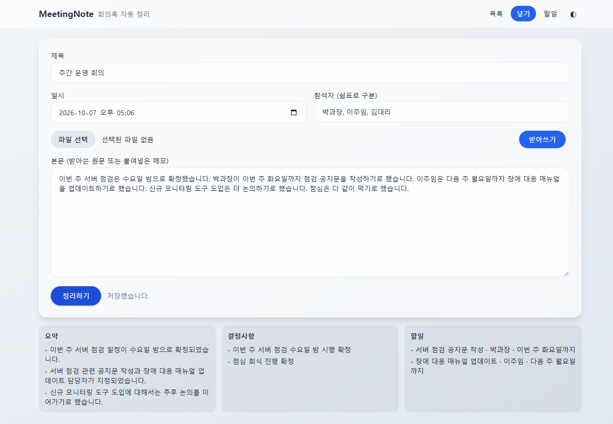
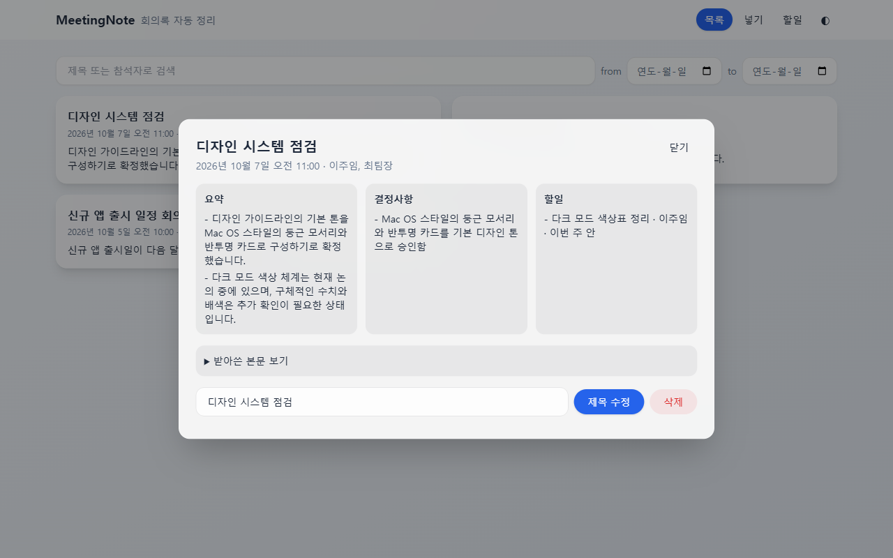
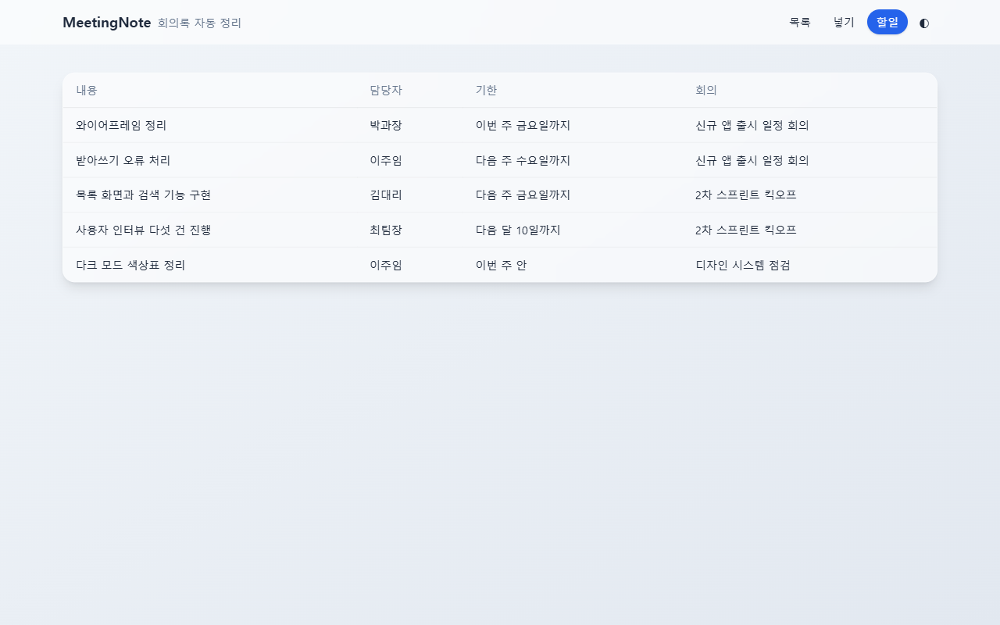
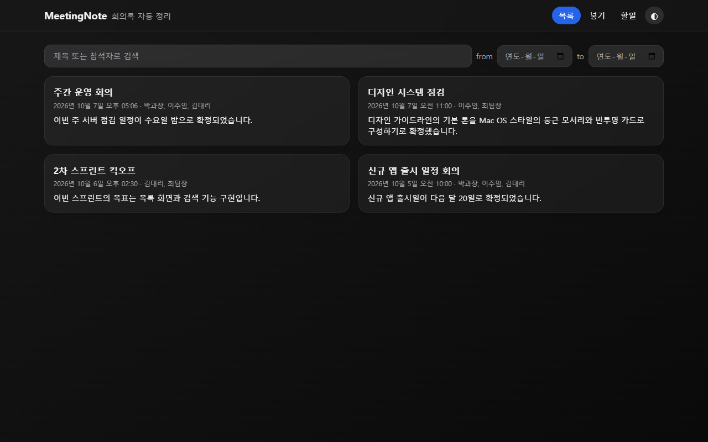
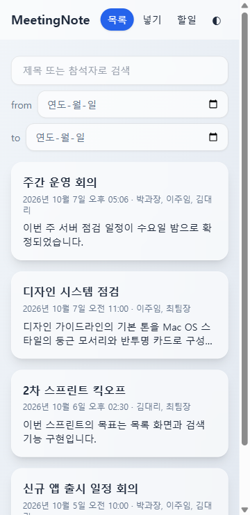
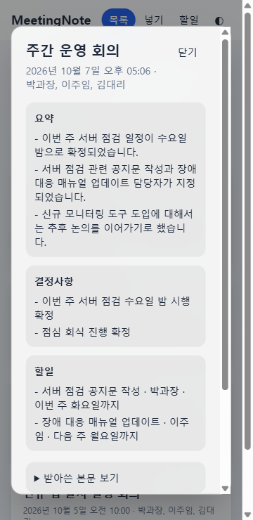

<div align="center">

# 📝 MeetingNote

**회의가 끝나면, 정리도 끝나 있게.**
녹취 파일 하나, 또는 메모 한 덩어리만 넣으면 **요약 · 결정사항 · 할 일** 세 갈래로 자동 정리해 주는 회의록 웹 앱




</div>

---

## ✨ 이런 걸 해결합니다

> "그때 뭐라고 했더라?"

주 3회 이상 회의에 들어가는 실무자를 위한 앱입니다. 회의 내용을 다시 듣거나 노트를 뒤지지 않아도, **무엇이 결정됐고 누가 언제까지 무엇을 하는지** 한 화면에서 바로 확인할 수 있습니다.

## 🎬 화면 둘러보기

### 넣기 — 녹취 파일 업로드 → 받아쓰기 → 세 갈래 정리

mp3 · wav 녹취(25MB 이하)를 올리면 Gemini가 받아쓰고, 본문을 **요약 / 결정사항 / 할일**로 나눠 줍니다. 메모를 직접 붙여넣어도 됩니다.



### 상세 · 할일 모아 보기

<table>
  <tr>
    <td width="50%"></td>
    <td width="50%"></td>
  </tr>
  <tr>
    <td align="center"><b>상세</b> · 세 갈래 결과와 받아쓴 본문, 제목 수정, 2단계 삭제</td>
    <td align="center"><b>할일</b> · 여러 회의의 담당자와 기한만 한 표로</td>
  </tr>
</table>

### 다크 모드 · 모바일 (360px)

<table>
  <tr>
    <td width="50%"></td>
    <td width="25%"></td>
    <td width="25%"></td>
  </tr>
  <tr>
    <td align="center"><b>다크 모드</b> · 시스템 설정을 따르고 직접 바꿀 수 있음</td>
    <td align="center" colspan="2"><b>모바일</b> · 360px에서도 깨지지 않음</td>
  </tr>
</table>

## 🚀 주요 기능

| 기능 | 설명 |
| --- | --- |
| 🎙️ 녹취 받아쓰기 | mp3 · wav (25MB 이하) 업로드 → Gemini 받아쓰기 |
| 🧠 세 갈래 자동 정리 | 요약(3~5줄) · 결정사항(합의된 것만) · 할 일(담당자·기한) |
| 🗂️ 회의록 CRUD | 추가 · 목록 · 수정 · 삭제를 화면에서 |
| 🔎 검색 | 제목·참석자 부분 일치, 날짜 범위(from · to) |
| ✅ 할 일 모아 보기 | 담당자와 기한을 표로, 회의 날짜 오래된 순 |
| 🌗 라이트 / 다크 | 시스템 설정으로 시작, 선택은 `localStorage` 에 저장 |
| 📱 반응형 | 360px 모바일 대응, Mac OS 스타일 UI |

받아쓰기나 정리가 실패해도 **회의록 저장은 그대로 성공**합니다. 이때 세 갈래는 비워 두고 화면에 "구분 실패"로 안내합니다.

## 🧱 기술 스택

| 영역 | 선택 |
| --- | --- |
| 백엔드 | FastAPI · Python 3.11+ · SQLAlchemy · SQLite |
| 프론트 | Vanilla JS + Tailwind CDN (`index.html`, `app.js` 2개 파일) |
| AI | Gemini API (`gemini-3.1-flash-lite`) — 받아쓰기와 세 갈래 구분 |
| 테스트 | pytest (실제 Gemini 호출, 대역 없음) |

프론트는 백엔드가 같은 오리진에서 제공하므로 CORS 설정이 필요 없습니다.

## ⚡ 빠르게 실행하기

```bash
# 1) 의존성 설치 (Python 3.11 이상)
python -m venv backend/.venv
backend/.venv/Scripts/python -m pip install -r backend/requirements.txt   # macOS/Linux: backend/.venv/bin/python

# 2) 프로젝트 루트에 .env 만들기
#    GEMINI_API_KEY=발급받은_키
#    GEMINI_MODEL=gemini-3.1-flash-lite

# 3) 서버 실행 (포트 8000 고정)
cd backend
.venv/Scripts/python -m uvicorn main:app --port 8000
```

| 주소 | 내용 |
| --- | --- |
| http://localhost:8000/ | 앱 화면 |
| http://localhost:8000/docs | Swagger (API 문서) |

> 🔐 API 키는 `.env` 로만 읽습니다. `.env` 는 `.gitignore` 에 들어 있어 저장소에 올라가지 않습니다.

## 🔌 REST API

모든 경로는 `/api/` 접두사를 씁니다.

| 메서드 | 경로 | 응답 | 설명 |
| --- | --- | --- | --- |
| POST | `/api/notes` | 201 | 저장하며 세 갈래 구분까지 |
| GET | `/api/notes` | 200 | 목록 (`q`, `from`, `to`), `body` 제외 |
| GET | `/api/notes/{id}` | 200 | 단건 (`body` 포함) |
| PUT | `/api/notes/{id}` | 200 | 수정 (id 를 뺀 전 필드) |
| DELETE | `/api/notes/{id}` | 204 | 삭제 |
| GET | `/api/todos` | 200 | 할 일만 모아 보기 |
| POST | `/api/upload` | 200 | 녹취 파일 → 받아쓴 본문 텍스트 |

오류 코드: 필수값 누락·형식 오류 `400` · 없는 id `404` · mp3/wav 아님 `415` · 25MB 초과 `413` · 스펙 외 필드 `422` · 받아쓰기 외부 호출 실패 `502`

## ✅ 테스트

```bash
cd backend
.venv/Scripts/python -m pytest -v
```

- **pytest 13케이스 전부 통과** — 생성·목록·단건·수정·삭제·검색·할 일, 400/404/422, 업로드 415/413
- **Swagger 25케이스 전부 통과** — Playwright 로 Swagger UI 를 직접 조작해 7개 API 전체를 점검 ([보고서](docs/swagger-test-report.md))
- 정상 생성 테스트는 **실제 Gemini** 를 호출합니다. 받아쓰기와 3항목 구분이 진짜 되는지는 실제로 불러 봐야 알 수 있기 때문입니다.

## 📁 폴더 구조

```text
meetingnote/
├── CLAUDE.md          # 작업 규칙 (역할 · 기술 스택 · 절대규칙)
├── backend/           # FastAPI · SQLAlchemy · Gemini 연동 · pytest
│   ├── main.py
│   ├── models.py
│   ├── schemas.py
│   ├── gemini_service.py
│   └── tests/
├── frontend/          # index.html + app.js (Tailwind CDN)
└── docs/              # 문서 6종 + 화면구성.pdf + 테스트 보고서
```

## 📚 문서 중심으로 만들었습니다

코드를 쓰기 전에 문서부터 정했습니다. 관심사 분리 원칙에 따라 한 문서는 한 가지 질문에만 답합니다.

| 문서 | 답하는 질문 |
| --- | --- |
| [00-overview](docs/00-overview.md) | 전체 지도 — 문서 구성, 화면 4종, 요소 id |
| [01-product](docs/01-product.md) | 무엇을, 왜 만드는가 |
| [02-specs](docs/02-specs.md) | 어떻게 동작해야 하는가 (모델 · API · 검증) |
| [03-design](docs/03-design.md) | 어떻게 짓는가 (선택과 트레이드오프) |
| [04-tasks](docs/04-tasks.md) | 무엇부터 하는가 (3개 Phase, 28단계) |
| [05-conventions](docs/05-conventions.md) | 어떤 규칙으로 쓰는가 (명명 · 금지 · 테스트 매트릭스) |

## 🧭 만든 순서

1. **Phase 1 · 설계** — `CLAUDE.md` + `docs/` 6종
2. **Phase 2 · 백엔드** — API 7개 + 받아쓰기 + Swagger 확인
3. **Phase 3 · 프론트** — 화면 4종 + API 연결

---

<div align="center">

Made with FastAPI · Tailwind · Gemini

</div>
